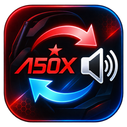

# Audio Switcher



Audio Switcher is a small Windows utility for switching audio outputs in one click. I built it as a quality-of-life improvement: a quick way to switch between my headset and my PC speakers.

Choose two playback profiles, each with its own general and communications outputs, or leave communications unchanged. Microphones are never changed.

Audio Switcher runs once and exits. There is no background app, startup entry, service, telemetry, or runtime download.

## Get started

You need **Windows 10/11, Windows PowerShell 5.1, .NET Framework**, two active playback outputs, and a permanent folder you can write to. No administrator rights, Visual Studio, or extra modules are required.

1. Download and extract the repository ZIP, or clone it. Keep `assets/icons/` intact; paths with spaces are supported.
2. Connect both outputs and open **Setup.cmd**. Choose general outputs A and B, then communications for each. Enter `0` for **Keep unchanged**, Enter to accept a suggestion, or `q` to cancel. For A50 X, put the base in PC mode.
3. Setup builds `AudioSwitcher.exe`, saves `audio-config.json`, and creates the **Audio Switcher** desktop shortcut without changing your current output. Click the shortcut or executable to switch.

Suggested profiles for an Astro A50 X setup (my current headset):

| Profile | General playback | Communications playback |
| --- | --- | --- |
| A: headset | A50 X Game | A50 X Voice |
| B: speakers | Your speakers | The same speakers |

Choose any two active playback outputs. Device names keep their Windows language; setup recognizes both `Speakers` and `Altavoces`. Selection uses saved endpoint IDs, not names or list positions.

## How it behaves

Each click reads the actual Windows **Console** default: **A → B; anything else → A**, including another output or no default. General playback sets the Console and Multimedia roles; communications uses its separate choice or preserves its previous default.

Required outputs are checked before switching. A missing output causes no changes; a failure during switching triggers a best-effort restoration and reports any incomplete recovery. These Windows calls are not an atomic transaction. Overlapping runs are ignored. Successful switches are silent; errors appear in a dialog.

Volume, EQ, formats, names, drivers, microphones, and app settings stay untouched. The tool does not depend on G HUB, battery level, or base detection, control the base mixer, or redirect a console's HDMI audio to PC speakers.

**Apps must follow Windows defaults** to follow these profiles. An app fixed to a specific device keeps using it; its “default” may mean general playback or communications, and it must support changing outputs during playback.

## Build and update

`Setup.cmd` builds during configuration. To rebuild and update the shortcut **without changing settings or audio**, open Windows PowerShell in the project folder:

```powershell
powershell.exe -NoLogo -NoProfile -STA -ExecutionPolicy Bypass -File ".\AudioSwitcher.ps1" -Build
```

For an update, close any running switch/setup, back up the installation folder, copy in the new files, **keep `audio-config.json`**, and run that command. If moving folders, copy your configuration before building and update old shortcuts manually. Recreate old Start/taskbar pins from the new shortcut.

Run `Setup.cmd` again only to change choices or recover changed device IDs. It suggests existing choices and backs up settings before replacing them. A failed compilation keeps the working executable.

The locally built executable is unsigned. Managed security policies can restrict it; the commands do not change global policy or override organization protections.

<details>
<summary>Updating an earlier local installation</summary>

Existing profile settings remain compatible. Older configurations without separate communications choices need setup once. The known `Alternar audio.lnk` is migrated only if it belongs to this installation; unrelated shortcuts are preserved.

After verifying the new shortcut, you may remove obsolete `AlternarAudio.exe`, `AlternarAudio.ps1`, `Lanzador.cs`, `Configurar.cmd`, `Listar.cmd`, `Probar.cmd`, `LEEME.txt`, and `pruebas/`. Keep your configuration and backups. Automation should use `AudioSwitcher.ps1`; the old parameter names `-Configurar`, `-Listar`, `-Silencioso`, and `-DesdeLanzador` remain aliases.

</details>

## Icons

`assets/icons/icon_round.ico` is embedded in the executable and used by the shortcut. The unchanged multiresolution alternatives, `icon_transparent.ico` and `icon_gamer.ico`, are in the same folder.

Choose an alternative through **shortcut Properties → Shortcut → Change Icon**. Rebuilding preserves your selection; the executable retains the round icon. If Explorer shows a cached icon, refresh it and recreate the affected pin. Check the executable directly too. No system cache cleanup runs automatically.

## Troubleshooting and tests

- **ListDevices.cmd** lists active playback outputs and all three defaults without changing them.
- **TestSwitch.cmd** deliberately **switches audio once**, printing the result in a visible console.

For missing outputs, check connections, enablement, and PC mode; rerun setup if an ID changed. Native Windows errors may use your system language. Do not include personal device IDs or `audio-config.json` in public issue reports; configuration, backups, binaries, shortcuts, and logs are excluded from Git.

<details>
<summary>Automatic and manual checks</summary>

Run these from Windows PowerShell in the project folder. They also run in GitHub Actions and never switch real audio or modify your desktop:

```powershell
powershell.exe -NoLogo -NoProfile -ExecutionPolicy Bypass -File ".\tests\Test-Logic.ps1"
powershell.exe -NoLogo -NoProfile -ExecutionPolicy Bypass -File ".\tests\Test-CoreAudio.ps1"
powershell.exe -NoLogo -NoProfile -ExecutionPolicy Bypass -File ".\tests\Test-Build.ps1"
powershell.exe -NoLogo -NoProfile -ExecutionPolicy Bypass -File ".\tests\Test-Shortcut.ps1"
```

Coverage includes profile selection, configuration, simulated failures and recovery, compilation in paths with spaces, exact embedded icon resources, and shortcut migration in a temporary folder.

Separately, when changing real audio is convenient:

1. Note playback defaults with `ListDevices.cmd` and microphone settings in Windows. Check the executable and shortcut icons in Explorer.
2. Click twice to check A → B → A, Game/Voice separation, unchanged microphones, no console flash or success dialog, and no lingering processes after completion/error dismissal.
3. Check a third output → A, **Keep unchanged**, and an unavailable required output failing before any change.

Automated tests cannot establish hardware compatibility or visual behavior on your machine.

</details>

<details>
<summary>Implementation</summary>

`AudioSwitcher.ps1` handles setup, selection, build, and shortcuts; `CoreAudio.cs` handles playback-only interop; `Launcher.cs` launches the short-lived PowerShell child.

The .NET Framework compiler builds a GUI executable with a Win32 icon resource. The launcher uses `UseShellExecute = false`, `CreateNoWindow = true`, and a quoted `-File` path, draining both output streams concurrently. Both processes exit after completion or error dismissal.

Core Audio enumerates playback endpoints and reads defaults. Setting them uses the undocumented `IPolicyConfig::SetDefaultEndpoint`; future Windows compatibility is not guaranteed. Capture endpoints and the registry are not modified directly.

</details>

## Uninstall

Remove your shortcut, pins, and installation folder. Keep `audio-config.json` if you want to reuse your profiles. The last audio defaults remain selected and can be changed normally in Windows.

*This is an unofficial project, unaffiliated with Logitech or Astro.*
